

  

<h3 align="center">FlaxOS</h3>

  <em>weave your knowledge · 织你所知</em>

---

**FlaxOS** 是一套面向墨水屏场景的轻量本地学习系统，核心是「知卡 FlaxCard」：把 Anki 牌组的文本、图片、公式、音频等卡面尽量在墨水屏上还原。

当前适配：**SF32LB525 · 3.68 英寸 528×792 墨水屏**

当前版本：**v1.19.0**（2026-10）

## 能做什么

### 学习

- Anki 牌组导入：选择题、挖空、翻页卡
- 选择题专项支持：单选、多选、题图、答案解析
- 富文本卡面：图片、LaTeX 公式、内联音频等
- 翻页、滚动、排版按墨水屏特性优化

> Anki 原生没有选择题界面；知卡在设备端补上了可点选、可判分的选择题 UI（单选/多选、题图、解析）。

### 不止学习

- 数独（经典/杀手）、番茄钟、天气、日历、计算器
- 本地音乐支持 AAC/MP3/WAV
- 网络电台支持 MP3/AAC
- 蓝牙耳机开盖即连、回仓断开
- LocalSend 局域网互传

## 实机演示

[▶ 实机演示视频]

早期演示（v1.3.0）[点击展开]

https://github.com/user-attachments/assets/07e6bb3f-9b9e-43a7-a1fa-1a86fc13fc40

### v1.19 效果预览
| 知卡 | 不止|学习  |
|:---:|---:|:---|
| 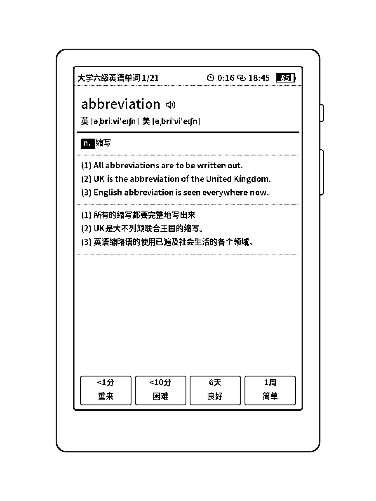 | 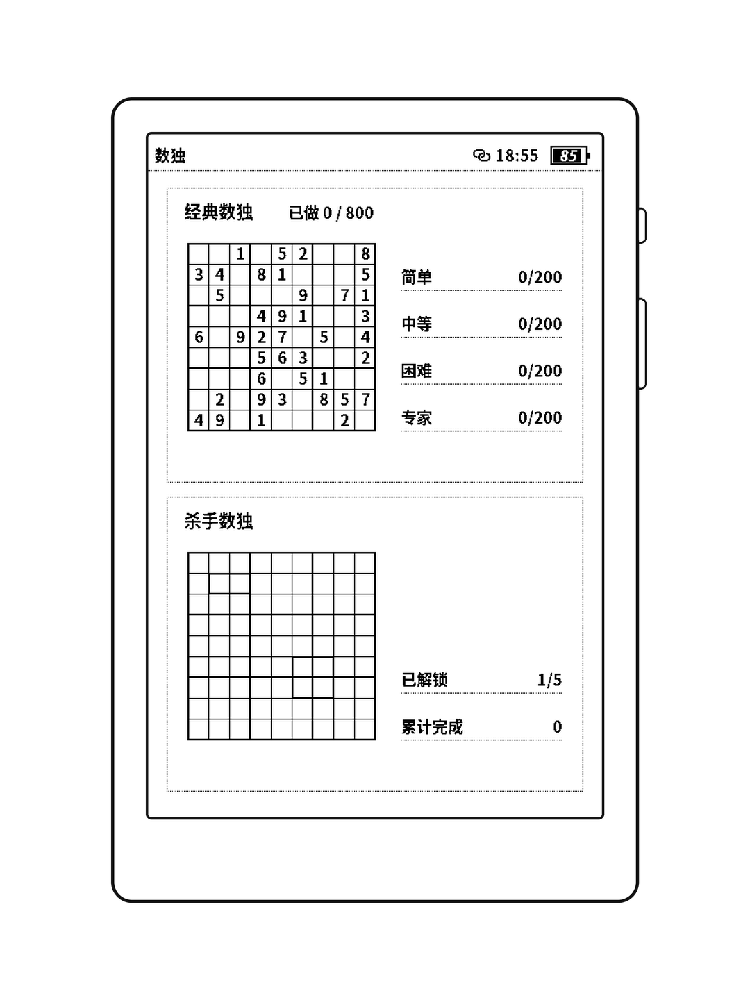 | 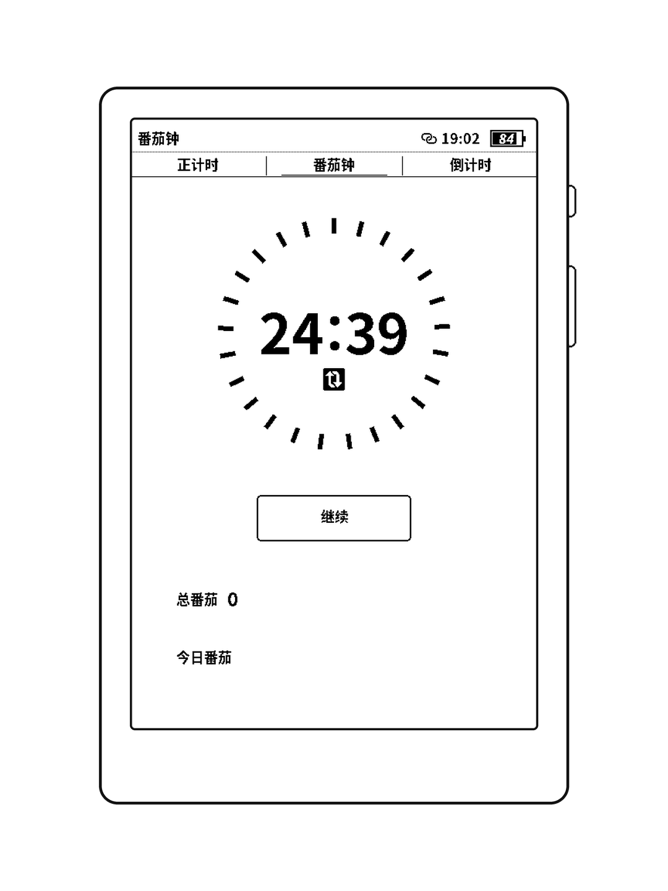 |
| 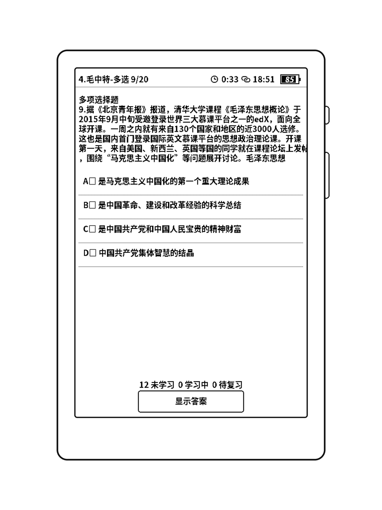 | 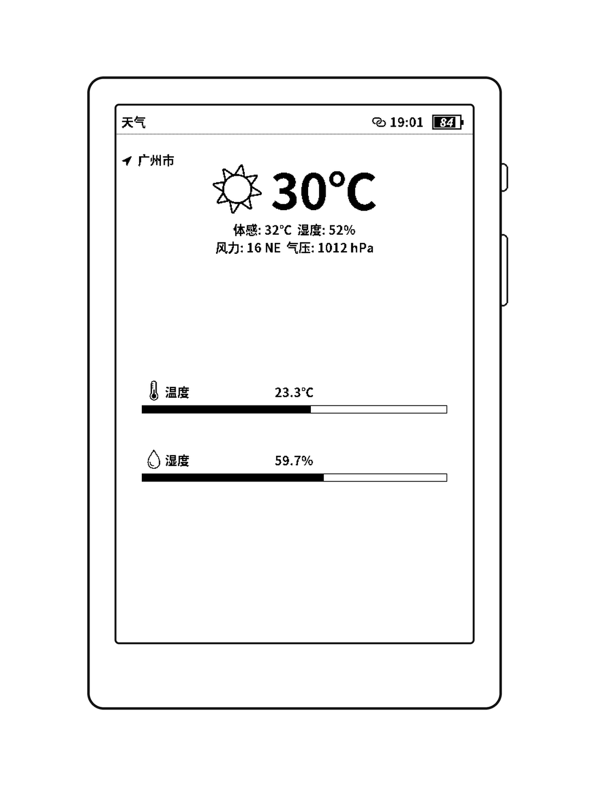 | 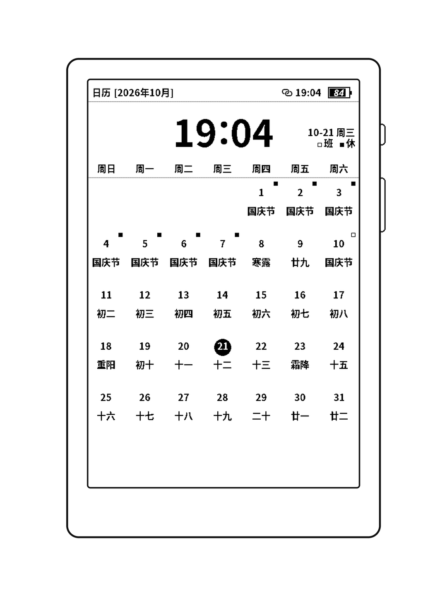 |
| 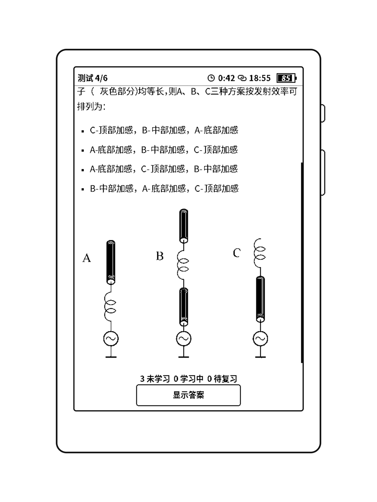 | 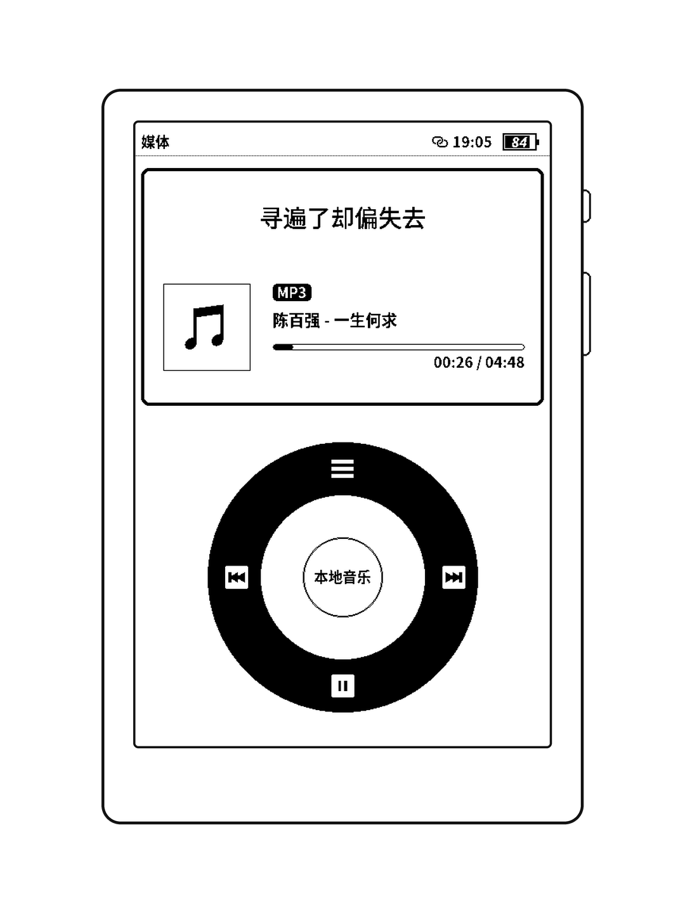 | 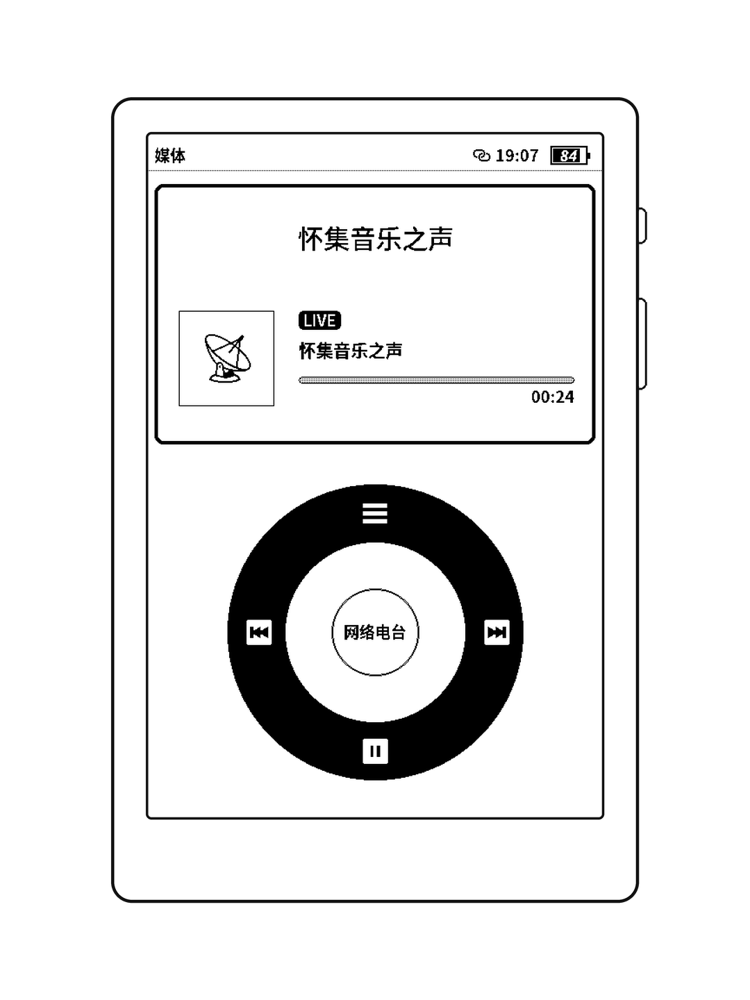 |
| 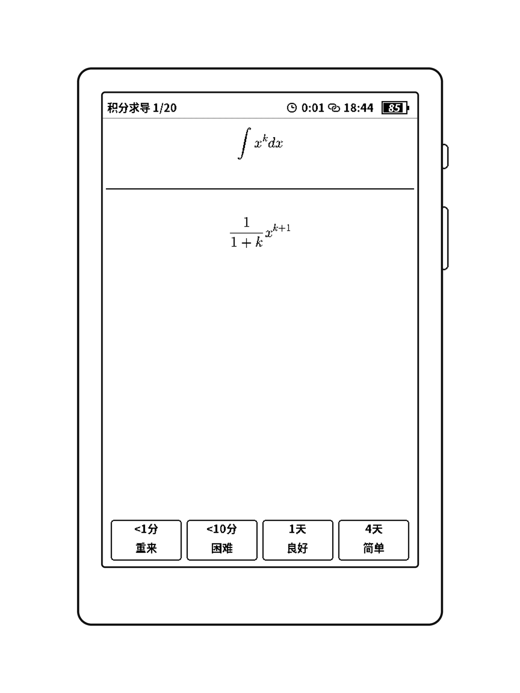 | 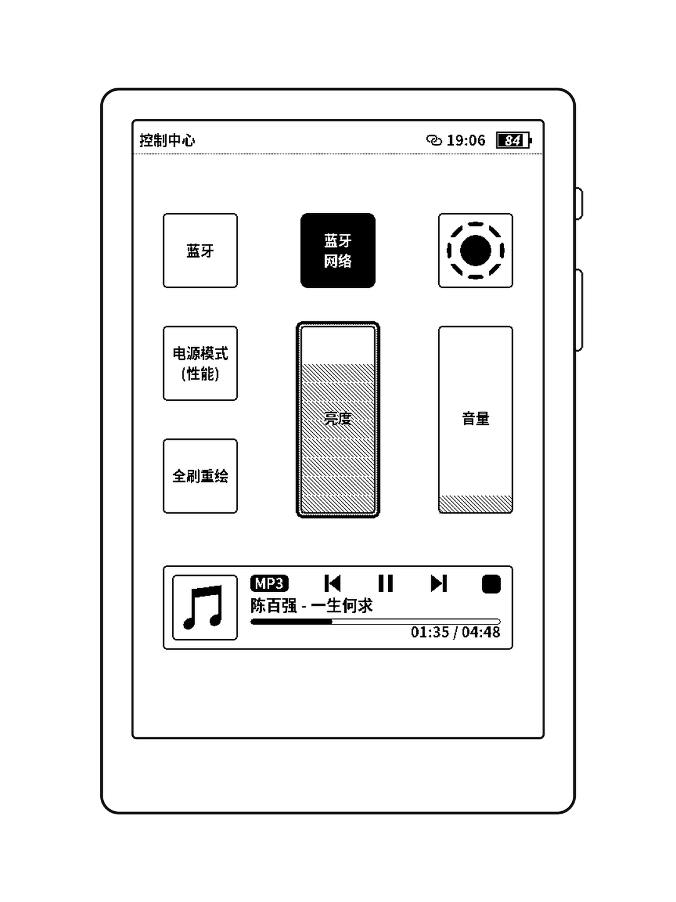 | [更多](mockups) |

## 当前状态

- 当前为实机演示阶段；固件/安装包发布见 [Releases](https://github.com/7b8k/FlaxOS/releases)。
- 源码私有开发中，本仓库用于展示与发布。
- 如果你在备考、背单词，欢迎提功能建议或使用场景。

名字与术语：FlaxOS、FlaxCard、SFC 是什么？[点击展开]

- **FlaxOS**：Flax + OS。Flax 是亚麻，织布、造纸的原料；借“纸/墨”之意象，做一套适配墨水屏的系统。
- **FlaxCard / 知卡**：Flax + Card，英文发音接近 flashcard；中文取“织”与“知”同音，叫「知卡」。它是 FlaxOS 里的学习模块。
- **SFC（Simple Flashcard）**：知卡的牌组文件格式。

## 版权

Copyright (c) 2026 7b8k. All rights reserved.

FlaxOS、FlaxCard、知卡为 7b8k 的项目名称。本仓库及 Releases 中的图片、视频、文案与固件仅用于 FlaxOS 展示；未经许可不得转载、二次分发或商用。

完整许可见 [LICENSE](LICENSE)。
